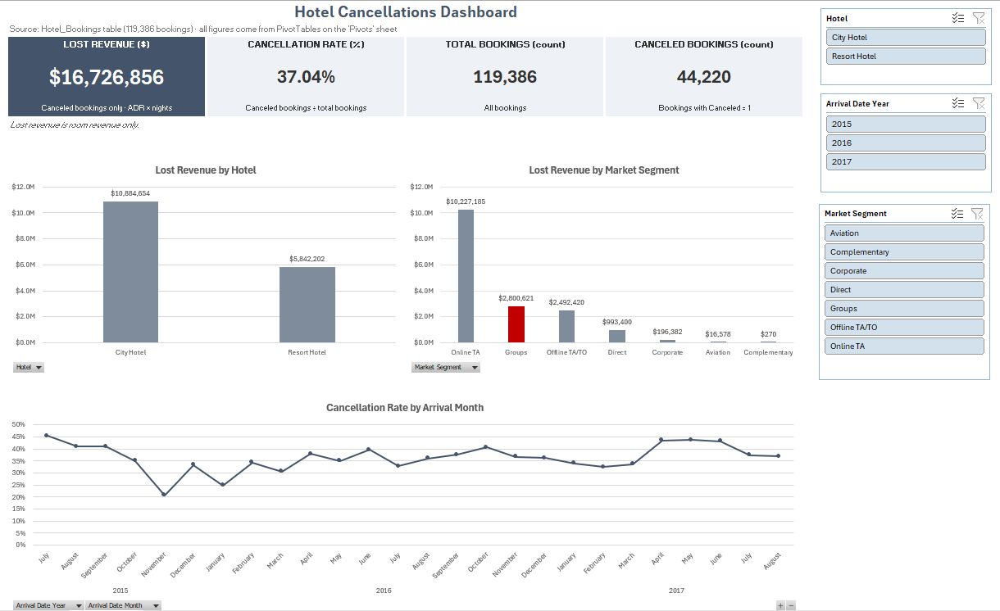

[Hotel_Cancellations_Dashboard_README.md](https://github.com/user-attachments/files/34255924/Hotel_Cancellations_Dashboard_README.md)
# Hotel Cancellations Dashboard

119,386 bookings · 37.04% cancellation rate · $16,726,856 in lost revenue (room revenue only)

## What it shows

- **Lost revenue by hotel** — City Hotel $10,884,654, Resort Hotel $5,842,202
- **Lost revenue by market segment** — Online TA $10,227,185, Groups $2,800,621, Offline TA/TO $2,492,420, Direct $993,400, Corporate $196,382, Aviation $16,578, Complementary $270
- **Cancellation rate by arrival month** — July 2015 to August 2017, low 20.8% (Nov 2015), high 45.4% (Jul 2015)
- **Cancellation rate by deposit type** — No Deposit 28.37%, Non Refund 99.36%, Refundable 22.22%
- **Cancellation rate by lead time bucket** — 0–30 days 18.56%, 31–90 days 37.70%, 91–180 days 44.71%, 181+ days 57.01%
- **Groups deep-dive** — 19,811 bookings, 61.06% cancellation rate, $2,800,621 lost revenue (market_segment = Groups)

## Headline numbers

| Metric | Value |
|---|---|
| Total bookings | 119,386 |
| Canceled bookings | 44,220 |
| Cancellation rate | 37.04% |
| Lost revenue | $16,726,856 |
| Kept revenue | $25,996,324.21 |

Lost revenue is room revenue only: for canceled bookings only, ADR × nights. All totals tie back to the source data.

## Recommendations

1. **Groups:** Tighten group booking terms around deposit requirements and block cutoff dates. Group cancellations are running at 61.06%, well above the overall rate of 37.04%, representing a $2.8M revenue drag.
2. **Online TA:** Priority focus: Online TA cancellation terms and controls. Online TA represents the largest revenue loss at $10,227,185. Given the scale, even incremental rate improvements here yield significantly higher dollar returns than larger percentage gains in minor channels.
3. **Long lead time:** Add deposit or reconfirmation steps for bookings made 181+ days out. Those cancel at 57.01%, versus 18.56% for bookings made within 30 days.

## How to use it

Open `Hotel_Cancellations_Dashboard.xlsx` in Excel.

- Start on the **Dashboard** sheet.
- Use the **Hotel**, **Arrival Year**, and **Market Segment** slicers on the right to filter the KPI tiles and charts.
- All figures come from PivotTables on the **Pivots** sheet, built from the **hotel_bookings** table.
- The Groups deep-dive stays focused on Groups (market_segment = Groups).

## Files

- `Hotel_Cancellations_Dashboard.xlsx` — the dashboard workbook
- `dashboard-top.png` — Dashboard top: KPI tiles, lost revenue by hotel and by market segment, cancellation rate by arrival month
- `dashboard-bottom.png` — Dashboard bottom: cancellation rate by deposit type and lead time, Groups deep-dive, recommendations
- `README.md` — this file

## Source and notes

- Source: Hotel Booking Demand dataset, Kaggle. Real hotel PMS data; hotel and customer identities are confidential in the original, so this dashboard shows aggregates only — no guest-level detail.
- Coverage: City Hotel and Resort Hotel, bookings due to arrive July 2015 – August 2017.
- Built in Excel with PivotTables, PivotCharts, and slicers, and finished with Copilot.
