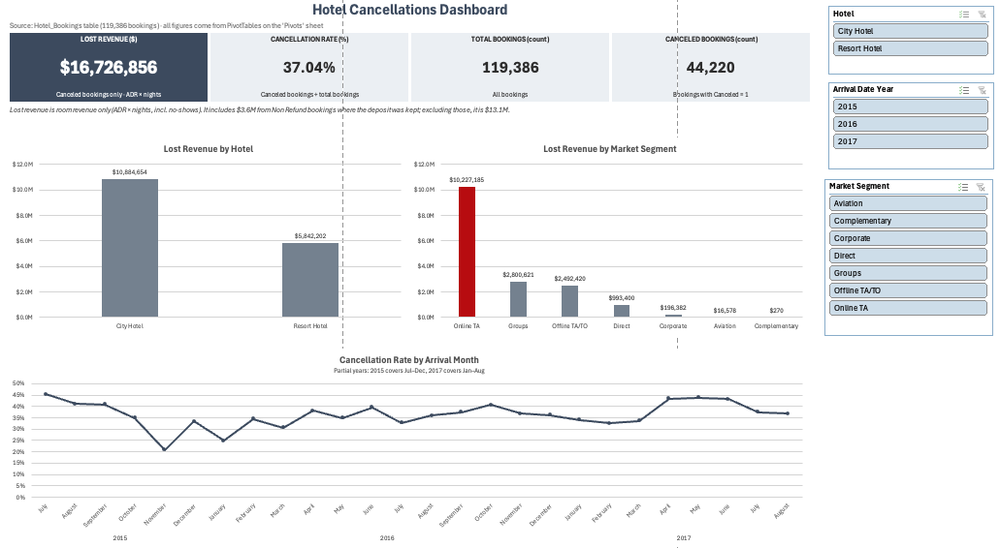
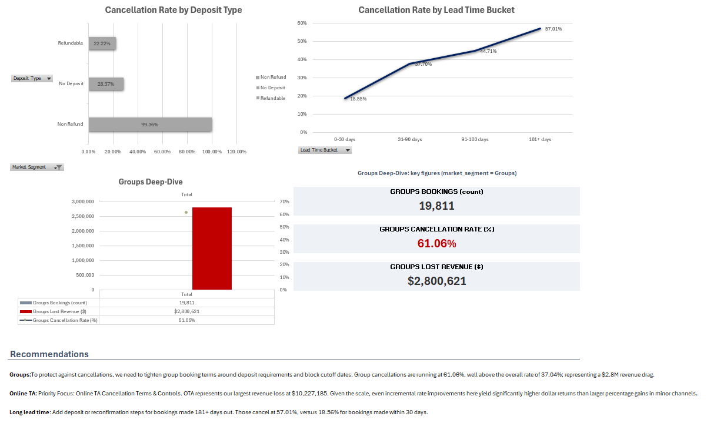

# Hotel Cancellations Dashboard

119,386 bookings · 37.04% cancellation rate · $16,726,856 in lost revenue (room revenue only)

*Screenshots show v1 of the dashboard. See [What changed in v2](#what-changed-in-v2).*

## What it shows

- **Lost revenue by hotel** — City Hotel $10,884,654, Resort Hotel $5,842,202
- **Lost revenue by market segment** — Online TA $10,227,185, Groups $2,800,621, Offline TA/TO $2,492,420, Direct $993,400, Corporate $196,382, Aviation $16,578, Complementary $270
- **Cancellation rate by arrival month** — July 2015 to August 2017, low 20.8% (Nov 2015), high 45.4% (Jul 2015)
- **Cancellation rate by deposit type** — No Deposit 28.37%, Non Refund 99.36%, Refundable 22.22%
- **Cancellation rate by lead time bucket** — 0–30 days 18.56%, 31–90 days 37.70%, 91–180 days 44.71%, 181+ days 57.01%
- **Groups key figures** — 19,811 bookings, 61.06% cancellation rate, $2,800,621 lost revenue (market_segment = Groups)
- **Data notes** — context for the deposit chart, partial years, and known data quirks

## Headline numbers

| Metric | Value |
|---|---|
| Total bookings | 119,386 |
| Canceled bookings | 44,220 |
| Cancellation rate | 37.04% |
| Lost revenue | $16,726,856 |
| Lost revenue excluding Non Refund bookings | $13,122,483 |
| Kept revenue | $25,996,324.21 |

Lost revenue is room revenue only: ADR × nights for canceled bookings (no-shows included). It includes $3,604,373 from Non Refund bookings, where the hotel kept the deposit, so the true loss is closer to $13.1M. All totals tie back to the source data.

## Recommendations

1. **Groups:** Tighten group booking terms around deposit requirements and block cutoff dates. Group cancellations are running at 61.06%, well above the overall rate of 37.04%, representing a $2.8M revenue drag.
2. **Online TA (priority):** Tighten OTA cancellation terms and controls. Online TA is the largest revenue loss at $10,227,185, so even small rate improvements here return more dollars than bigger percentage gains in minor channels.
3. **Long lead time:** Add deposit or reconfirmation steps for bookings made 181+ days out. Those cancel at 57.01% ($4.8M in lost revenue), versus 18.56% for bookings made within 30 days.

## How to read it

- **Non Refund at 99%:** most Non Refund bookings are Groups (9,172) and Offline TA/TO (5,006). The rate reflects how those channels book, not an effect of taking deposits.
- **Partial years:** 2015 covers July–December and 2017 covers January–August, so yearly totals are not directly comparable.
- **Data quirks, left as is:** one booking has a $5,400 ADR and one has a negative ADR. The `Arrival Week Date Day` column holds the week number.

## How to use it

Open `Hotel_Cancellations_Dashboard.xlsx` in Excel.

- The PivotTables rebuild from the **hotel_bookings** table when the file opens, which takes a few seconds.
- Start on the **Dashboard** sheet.
- Use the **Hotel**, **Arrival Year**, and **Market Segment** slicers on the right to filter the KPI tiles and charts.
- *Lost revenue by market segment* and the Groups key figures ignore the Market Segment slicer, so they always show every segment and Groups respectively.
- All figures come from PivotTables on the **Pivots** sheet, built from the **hotel_bookings** table.

## What changed in v2

- Fixed the KPI tiles: v1 was saved with the Market Segment slicer set to Groups, so the tiles showed Groups-only figures.
- Disconnected the segment chart and Groups pivots from the Market Segment slicer.
- Added the Non Refund note under the tiles, chart subtitles for the deposit and month charts, and a Data notes block.
- Replaced the Groups deep-dive chart with the notes block (the Groups tiles stay).
- Stopped saving a second copy of the data in the pivot cache, shrinking the file from 23 MB to 20 MB.

## Files

- `Hotel_Cancellations_Dashboard.xlsx` — the dashboard workbook (v2)
- `dashboard-top.png` — v1 screenshot: KPI tiles, lost revenue by hotel and by market segment, cancellation rate by arrival month
- `dashboard-bottom.png.png` — v1 screenshot: cancellation rate by deposit type and lead time, Groups deep-dive, recommendations
- `README.md` — this file

## Source and notes

- Source: Hotel Booking Demand dataset, Kaggle. Real hotel PMS data; hotel and customer identities are confidential in the original, so this dashboard shows aggregates only — no guest-level detail.
- Coverage: City Hotel and Resort Hotel, bookings due to arrive July 2015 – August 2017.
- Built in Excel with Power Query, PivotTables, PivotCharts, and slicers, and finished with Copilot. Audited and revised (v2) with Claude.
